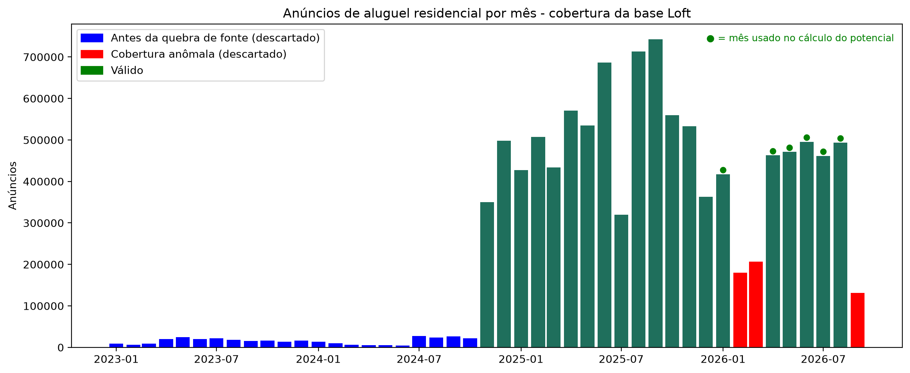
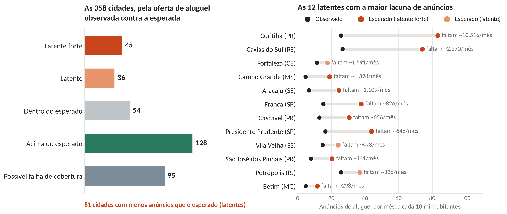
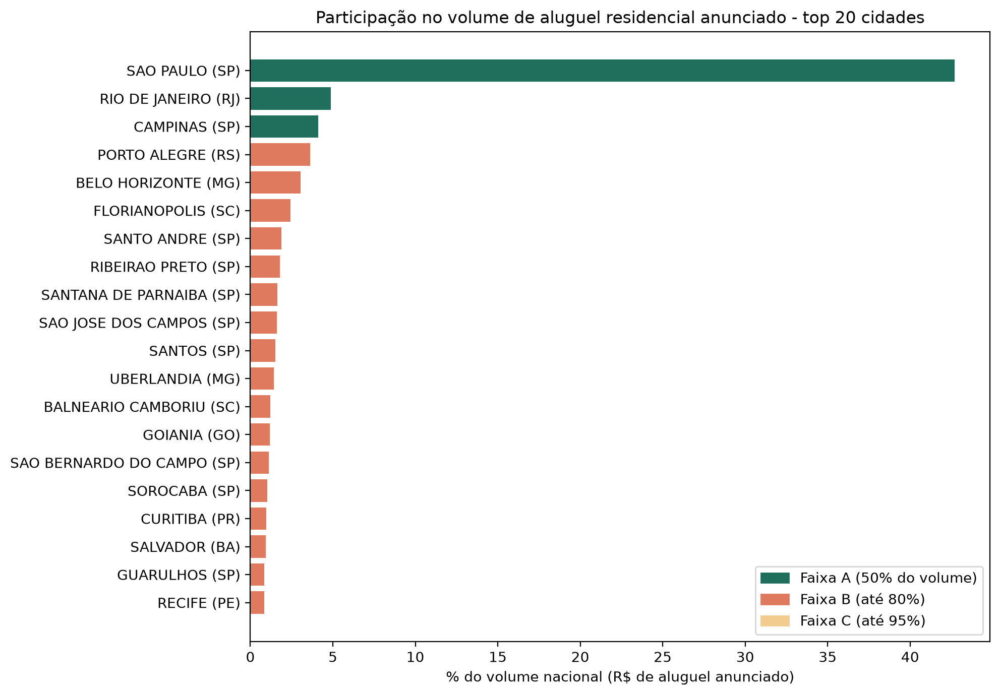
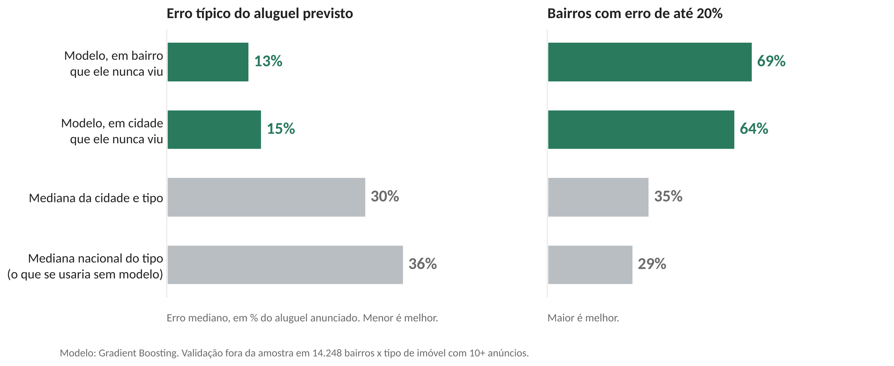
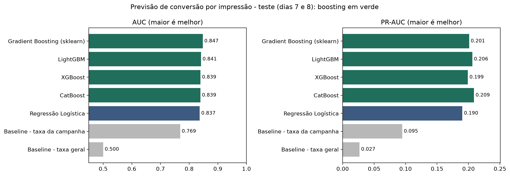
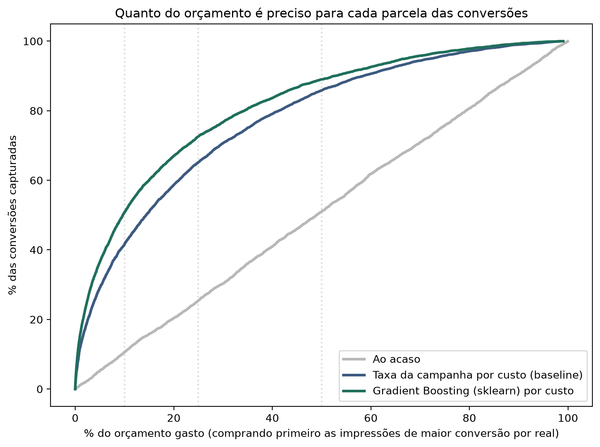
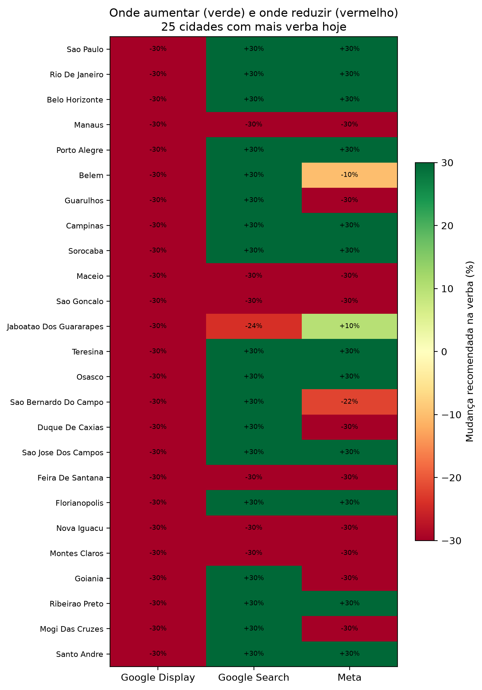
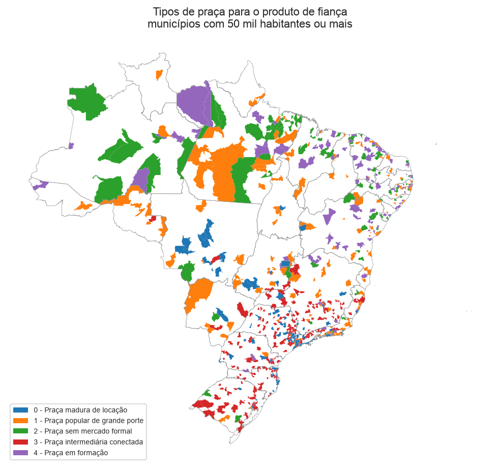
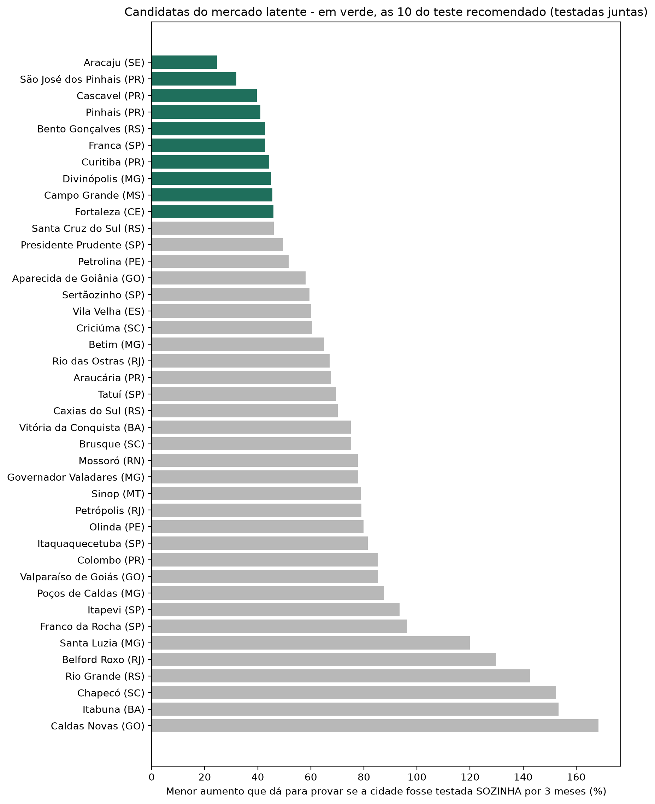

# Onde colocar o próximo real de mídia?

### Projeto de Ciência de Dados V · IBMEC · 2026 · parceria com a Loft (fiança locatícia)

**Repositório:** `ibmecPCDV20261_victor_lucas_beatriz_ravi` · **Python:** 3.13

| Integrante | E-mail |
|---|---|
| Victor Garcia | victorjg252@gmail.com |
| Lucas Nauer | lucasnauer@gmail.com |
| Beatriz Babinski | bfbabinski@gmail.com |
| Ravi Oberg | oberg.ravi@gmail.com |

---

## Sumário

1. [Resumo](#1-resumo)
2. [Problema de negócio](#2-problema-de-negócio)
3. [Dados](#3-dados)
4. [Princípio de validação](#4-princípio-de-validação)
5. [Frente supervisionada: qual campanha?](#5-frente-supervisionada-qual-campanha)
6. [Frente não supervisionada: em qual lugar?](#6-frente-não-supervisionada-em-qual-lugar)
7. [Juntando as duas frentes](#7-juntando-as-duas-frentes)
8. [Teste geográfico: como provar o efeito](#8-teste-geográfico-como-provar-o-efeito)
9. [Limitações](#9-limitações)
10. [Próximos passos](#10-próximos-passos)
11. [Estrutura do repositório](#11-estrutura-do-repositório)
12. [Como rodar](#12-como-rodar)
13. [Uso de IA](#13-uso-de-ia)

---

## 1. Resumo

A Loft quer saber **em quais praças colocar o próximo real de mídia paga, e de quais retirar**, para o produto de fiança locatícia. Cerca de 74% das peças de anúncio públicas da Loft são de fiança, e o cliente principal é a imobiliária.

A dificuldade é que **ainda não recebemos os dados internos de mídia da Loft** (investimento, MQLs e cadastros). Sem esse dado, não existe um rótulo de "praça boa". Por isso o projeto foi dividido em duas frentes, cada uma validada contra baselines e fora da amostra:

| Frente | Pergunta | Tipo de aprendizado | Principal resultado |
|---|---|---|---|
| 1 | **Qual campanha?** Onde cada real rende mais | Supervisionado | Mercado latente com R² de 0,74 (contra 0,40 do melhor baseline); valor do lead com erro de 13% (contra 30%); Criteo com AUC de 0,847 (contra 0,769); realocação simulada com +12,8% de MQLs |
| 2 | **Em qual lugar?** Que tipos de praça existem | Não supervisionado | 5 tipos de praça que separam as cidades muito melhor do que região ou porte (silhueta de 0,27 contra 0,005 e −0,11) e se repetem em amostras novas |

Juntas, as frentes respondem **em que tipo de praça colocar qual campanha**. Como nenhum dos modelos prova causalidade, o projeto termina com o **desenho de um teste geográfico** que mede o efeito real da mídia.

Cada resultado deste relatório está marcado pela sua natureza: **observado** (está nos dados), **modelo** (previsão validada fora da amostra) ou **simulado** (usa dados sintéticos com resposta conhecida).

---

## 2. Problema de negócio

Em mídia paga, o **custo médio** por conversão esconde o **custo da próxima conversão**. Ordenando as impressões da base Criteo pela conversão prevista por real, quando já se gastou metade do orçamento a conversão adicional custa 0,56 vez o custo médio; na última faixa do orçamento, custa **13,8 vezes** o custo médio. *(observado)*

Decidir verba olhando só o custo médio leva a investir demais onde o retorno já está saturado. A decisão precisa da **curva de retorno marginal**, e essa curva muda conforme a campanha e a praça. Daí as duas perguntas do projeto: qual campanha e em qual lugar.

---

## 3. Dados

| Base | Conteúdo | Uso no projeto | Natureza |
|---|---|---|---|
| **Municípios públicos** | 687 municípios com 50 mil habitantes ou mais (70% da população), 16 variáveis de CNPJ, CAGED, Banco Central, Anatel, IBGE, CadÚnico e Senatran | Tipos de praça; variáveis do mercado latente | Dado público |
| **Anúncios de portais (Loft)** | Aluguel e venda por cidade, bairro e tipo de imóvel; 530 cidades, 358 cruzadas com a base pública | Tamanho do mercado, valor do lead, alvo do mercado latente, validação das praças | Fornecido pela Loft (fora do repositório) |
| **Criteo Attribution Modeling** | 1 milhão de impressões, 673 campanhas, 9 dias, 2,65% de conversão | Prever conversão e priorizar impressões por retorno | Público de terceiros |
| **Mídia simulada** | Formato combinado com a Loft: data, canal, campanha, UF, cidade, investimento, MQLs e cadastros | Validar o método de realocação de verba | Simulado |

**Auditoria dos anúncios.** A base de anúncios tem uma quebra de fonte em 2024: antes de novembro de 2024 a cobertura é de 20 a 50 vezes menor, por mudança de coleta e não de mercado. Por isso só entram aluguel residencial (apartamento e casa, sem contar o mesmo anúncio duas vezes) e meses com volume acima de 60% da mediana. Resultado: 355 cidades; 3 concentram 50% do volume e 22 concentram 80%. *(observado)*



As bases não são versionadas no GitHub, por tamanho e por confidencialidade. Cada integrante mantém os arquivos localmente e informa o caminho no `.env` (ver [seção 12](#12-como-rodar)).

---

## 4. Princípio de validação

Todo modelo do projeto precisa cumprir duas regras:

1. **Superar baselines que a Loft teria de graça**: média, mediana da UF, mediana da cidade, mediana do tipo de praça, taxa histórica da campanha ou custo médio, conforme a frente.
2. **Ser testado fora da amostra**, no teste mais difícil que fizer sentido: município novo, estado nunca visto, cidade nunca vista ou semanas futuras.

| Frente | Modelos | Validação | Baselines |
|---|---|---|---|
| Mercado latente | Ridge, Random Forest, Gradient Boosting | KFold 5×5 e agrupada por UF | Média geral, mediana da UF, mediana do tipo de praça |
| Valor do lead | Ridge, Random Forest, Gradient Boosting | KFold 5 e GroupKFold por cidade | Mediana nacional do tipo, mediana da cidade e tipo |
| Criteo | Logística, Gradient Boosting, XGBoost, LightGBM, CatBoost | Temporal: treino nos dias 0 a 5, validação no 6, teste nos dias 7 e 8 | Taxa geral, taxa da campanha |
| Realocação | Regressão de Poisson, Gradient Boosting monotônico | Últimas 8 semanas, com resposta certa simulada | Custo médio geral, custo médio por praça e canal |
| Tipos de praça | KMeans, Ward, Mistura Gaussiana (k de 2 a 10) | Silhueta, reamostragem, metades, sementes | Regiões do IBGE, porte populacional, sorteio |
| Teste geográfico | KNN, controle sintético, Ridge | Ensaio no passado (placebo) | Cidades sorteadas, sem comparação |

---

## 5. Frente supervisionada: qual campanha?

Aqui sempre existe uma resposta conhecida nos dados, e o modelo aprende a prevê-la.

### 5.0 POC inicial: conversões por campanha e hora (primeira entrega)

**Script:** `notebooks/01_poc.py` · **Docker:** `Dockerfile` e `docker-compose.yml`

A primeira entrega validou o pipeline com uma amostra de 100 mil impressões da Criteo, agregadas por campanha e hora, para prever o número de conversões. A divisão de treino e teste foi temporal.

| Modelo | MAE | RMSE | R² |
|---|---:|---:|---:|
| Baseline mínimo (Dummy) | 1,22 | 3,39 | −0,03 |
| Baseline simples (taxa média × impressões) | 1,08 | 2,53 | 0,43 |
| **Regressão Linear** | **0,92** | **1,90** | **0,68** |
| Random Forest | 1,00 | 2,20 | 0,57 |

A Regressão Linear superou os dois baselines. Essa entrega estabeleceu a regra de validação usada no resto do projeto. O script `notebooks/02_poc_features_temporais_FUTURA.py` testa variáveis temporais e a Regressão de Poisson como extensão, e foi deixado como trabalho futuro. Fonte: `reports/tables/comparacao_modelos.csv`.

### 5.1 Mercado latente: onde falta oferta

**Notebook:** `notebooks/mercado_latente.ipynb`

**Pergunta.** Quantos anúncios de aluguel cada cidade deveria ter, dado o seu perfil?

**Alvo.** Anúncios de aluguel por 10 mil habitantes, em log, para as 358 cidades presentes nas duas bases.

**Resultado** *(modelo)*, R² fora da amostra:

| Modelo | KFold 5×5 (município novo) | Agrupada por UF (estado nunca visto) |
|---|---:|---:|
| Baseline média geral | 0,00 | −0,11 |
| Baseline mediana da UF | 0,08 | −0,15 |
| Baseline mediana do tipo de praça | 0,40 | 0,30 |
| Regressão Ridge | 0,65 | 0,40 |
| Random Forest | 0,71 | **0,60** |
| Gradient Boosting | **0,74** | 0,54 |

O Gradient Boosting quase dobra o melhor baseline. No teste mais duro, com estados que o modelo nunca viu, o Random Forest lidera com 0,60 contra 0,30. As variáveis que mais pesam são a população e as imobiliárias por 10 mil habitantes. Fonte: `reports/tables/08_comparacao_modelos.csv`.

**Oportunidade contra falha de cobertura.** Uma cidade com poucos anúncios pode ser oportunidade ou apenas um lugar que o portal cobre mal. Para separar os dois casos, o mesmo modelo foi treinado para anúncios de **venda** (R² de 0,73). Só é mercado latente a cidade com aluguel abaixo de 80% do esperado **e** venda dentro do esperado.

| Leitura | Cidades |
|---|---:|
| Mercado latente forte | 45 |
| Mercado latente | 36 |
| Dentro do esperado | 54 |
| Acima do esperado (mercado desenvolvido) | 128 |
| Possível falha de cobertura da base | 95 |

São **81 cidades latentes**. As maiores lacunas estão em Curitiba (cerca de 10,5 mil anúncios por mês abaixo do esperado), Caxias do Sul (2,3 mil), Fortaleza, Campo Grande e Aracaju (mais de mil cada). Brasília aparece como possível falha de cobertura. Fonte: `reports/tables/08_mercado_latente_municipios.csv`.



**Cidades fora da base da Loft.** O mesmo modelo estima o mercado esperado das 329 cidades com 50 mil habitantes ou mais que não aparecem nos anúncios. As maiores são Barueri (cerca de 3,7 mil anúncios de aluguel esperados por mês), Atibaia, Guarujá, Palhoça e Indaiatuba. Essas cidades são candidatas a expansão, e a mais forte delas, Barueri, é uma praça madura de locação. Fonte: `reports/tables/08_mercado_esperado_fora_da_base.csv`.

> **Cuidado:** a medida é de oferta anunciada, não de demanda. É uma lista de cidades para testar, não uma garantia de mercado.

### 5.2 Potencial de mercado: onde está o volume hoje

**Notebook:** `notebooks/03_potencial_mercado.ipynb`

Antes de modelar, a base de anúncios foi auditada e transformada em um ranking de potencial por UF, cidade e bairro: anúncios por mês, volume de aluguel em reais, aluguel e área medianos e tendência de participação entre os três meses mais recentes e os três anteriores. *(observado)*

O mercado é muito concentrado. Das 355 cidades, as 3 da faixa A (São Paulo, Rio de Janeiro e Campinas) somam 52% do volume de aluguel, as 19 da faixa B somam outros 29%, as 45 da faixa C somam 15% e as 288 da faixa D, só 5%. São Paulo sozinha responde por 43%. Entre as grandes, Porto Alegre é a que mais ganha participação (+25%). Fontes: `potencial_uf.csv`, `potencial_cidades.csv` e `potencial_distritos.csv` (2.229 bairros), em `reports/tables/`.



### 5.3 Valor do lead: quanto vale um cliente em cada bairro

**Notebook:** `notebooks/07_valor_lead.py` (e a versão `.ipynb`)

**Pergunta.** A fiança é cobrada como percentual do aluguel, então um lead num bairro de aluguel alto vale mais. Qual é o aluguel esperado em cada bairro e tipo de imóvel?

**Por que modelar.** Bairros com poucos anúncios têm mediana instável. O modelo usa área, condomínio, preço de venda no mesmo bairro, cidade e tipo para prever o aluguel, inclusive onde há pouco dado. O aluguel de referência mistura o observado e o previsto, com peso maior no observado quanto mais anúncios o bairro tem.

**Resultado** *(modelo)*, em 14.248 combinações de bairro e tipo com 10 ou mais anúncios:

| Previsão | Erro mediano no aluguel | Bairros com erro de até 20% | R² (log) |
|---|---:|---:|---:|
| Baseline mediana nacional do tipo | 36% | 29% | 0,17 |
| Baseline mediana da cidade e tipo | 30% | 35% | 0,32 |
| **Gradient Boosting, bairro novo (KFold)** | **13%** | **69%** | **0,87** |
| **Gradient Boosting, cidade nunca vista (GroupKFold)** | **15%** | **64%** | **0,84** |

O modelo erra **menos da metade** do que a melhor mediana e continua bom em cidades que nunca viu. Entre cidades com 200 ou mais anúncios, o valor do lead varia **2,7 vezes** entre o percentil 90 e o percentil 10: otimizar mídia só por quantidade de MQL ignora essa diferença.



O script também gera `07_comparacao_modelos.csv`, `07_aluguel_referencia_bairros.csv` e `07_valor_lead_cidades.csv`. Essas tabelas não estão no repositório porque são derivadas da base privada da Loft.

> **Limite:** mede o preço anunciado, não o aluguel fechado. O índice ainda precisa ser comparado com a receita real de fiança por praça.

### 5.4 Criteo: quais impressões convertem mais por real

**Notebook:** `notebooks/criteo_boosting.ipynb` (POC inicial em `notebooks/01_poc.py`)

**Pergunta.** Sem a mídia da Loft, usamos a base pública da Criteo para construir e validar o método de priorização: dada uma impressão, qual a chance de ela virar conversão?

**Alvo.** A impressão gerou uma conversão atribuída. Só entram variáveis disponíveis no momento da exibição, para não haver vazamento.

**Validação temporal.** Treino nos dias 0 a 5, validação no dia 6 e teste nos dias 7 e 8.

**Resultado** *(modelo)*, no teste:

| Modelo | AUC | PR-AUC |
|---|---:|---:|
| Baseline taxa geral | 0,500 | 0,027 |
| Baseline taxa da campanha | 0,769 | 0,095 |
| Regressão Logística | 0,837 | 0,190 |
| CatBoost | 0,839 | 0,209 |
| XGBoost | 0,839 | 0,199 |
| LightGBM | 0,841 | 0,206 |
| **Gradient Boosting (scikit-learn)** | **0,847** | **0,201** |

Os modelos de boosting ficam muito próximos entre si. O escolhido foi o Gradient Boosting do scikit-learn, que treina em 14 segundos, contra 701 do CatBoost.



**Uso na prática.** Ordenando as impressões por conversão prevista por real, **10% do orçamento captura 51% das conversões** (taxa da campanha: 42%; ao acaso: 11%), 25% do orçamento captura 73% e metade do orçamento captura 89%. As probabilidades estão bem calibradas: quando o modelo prevê 5%, a taxa real fica perto de 5%.



> **Cuidado:** o modelo ordena por chance de conversão; ele não demonstra que o anúncio causou a conversão.

### 5.5 Eficiência regional por cidade *(simulado)*

**Responsável:** Lucas Nauer · **Scripts:** `notebooks/04_eficiencia_regional.py`, `notebooks/05_exemplo_meta_simulado.py` e `notebooks/06_meta_para_midia.py`

Esta foi a primeira tentativa de responder onde a verba rende menos, por **cidade e mês**. A mídia é simulada, e o potencial e o aluguel de cada cidade vêm da base de anúncios. Para evitar vazamento, cada mês só usa os seis meses válidos do painel anteriores a ele, e o script confere isso no código.

- **Modelos:** Regressão Linear em log-log, em que o coeficiente do investimento é a **elasticidade** (quanto o resultado reage a +1% de verba), com e sem interação com o potencial da cidade; Random Forest para comparação.
- **Baselines:** Dummy, custo médio geral e, mais exigente, o custo observado de **cada cidade**.
- **Testes de sanidade:** alvo embaralhado (R² perto de zero, como esperado) e verificação contra a resposta certa do simulador.

**Resultado** *(simulado)*, ao rodar com a base da Loft:
- O baseline forte, que só decora o custo de cada cidade, iguala ou supera os modelos: RMSE de 250 contra 258 do Random Forest em MQLs.
- O ganho da realocação sai como uma faixa de +21% a +59% de MQLs, e a regra simples (tirar verba de quem tem o maior custo observado) dá praticamente o mesmo ganho.
- As ações sugeridas (reduzir, manter ou aumentar) concordam com a verdade do simulador em 73% das cidades, sem nenhuma ação invertida.

A conclusão do próprio script é que, com dado por cidade e mês, **o modelo não supera a regra simples**. A abordagem seguinte (seção 5.6) muda a unidade para praça e canal com dados semanais, e nela o modelo passa a vencer a regra simples.

Os outros dois scripts preparam a chegada do dado real. O `05` gera exemplos fictícios no formato da exportação do Gerenciador de Anúncios da Meta e do CRM da Loft, e o `06` converte a exportação da Meta e o arquivo de MQLs da Loft no formato que os modelos esperam.

### 5.6 Realocação de verba entre praças e canais *(simulado)*

**Notebook:** `notebooks/realocacao_verba.ipynb`

**Pergunta.** Com o orçamento atual, para onde mover a verba entre praças e canais para gerar mais MQLs?

**Dados.** Como a mídia da Loft ainda não chegou, foi gerada uma base sintética no formato combinado com a Loft, com uma **resposta certa escondida** (curvas de saturação por praça e canal). Isso permite medir se o método recupera a verdade. Os arquivos simulados estão marcados com `_SIMULADO` no nome.

**Modelo de resposta.** A Regressão de Poisson previu melhor as 8 semanas que não viu: erro semanal (RMSE) de 6,6 contra 19,7 do Gradient Boosting monotônico, e erro total de MQLs de 10,5% contra 12,1% do custo médio por praça e canal e 62,4% do custo médio geral. A correlação entre o custo do próximo MQL estimado e o verdadeiro foi de 0,97, contra 0,68 do Gradient Boosting.

**Otimização.** Com o modelo de Poisson, um otimizador redistribui a verba respeitando um limite de variação por praça e canal:

| Limite de variação | Regra simples | Poisson | Máximo possível |
|---|---:|---:|---:|
| 15% | +3,9% | +6,7% | +6,8% |
| **30%** | +7,2% | **+12,8%** | +12,9% |
| 50% | +10,8% | +19,9% | +20,1% |

Com o limite de 30%, o otimizador gera **+12,8% de MQLs** e +14,3% de cadastros, praticamente o máximo possível (12,9%). O modelo promete um pouco mais do que entrega: prevê +14,6% quando o ganho verdadeiro é 12,8%. Por isso o número que vale é o verdadeiro do simulador. Fonte: `realocacao_sensibilidade_limites_SIMULADO.csv`.

O resultado se mantém nos testes de estresse:

| Cenário | Regra simples | Poisson | Máximo possível |
|---|---:|---:|---:|
| Base | +7,1% | +11,9% | +12,3% |
| Saturação aleatória | +8,2% | +12,2% | +12,7% |
| Saturação aleatória + verba quase parada | +8,9% | +13,4% | +13,7% |

**Verba por tipo de praça.** Somando a recomendação por tipo de praça, a verba vai para onde o próximo MQL é mais barato: *(simulado)*

| Praça | Fatia da verba hoje | Custo médio por MQL | Custo do próximo MQL | Variação recomendada |
|---|---:|---:|---:|---:|
| Madura de locação | 56% | R$ 40 | R$ 91 | **+14%** |
| Intermediária conectada | 12% | R$ 72 | R$ 198 | −7% |
| Popular de grande porte | 24% | R$ 96 | R$ 254 | −19% |
| Em formação | 6% | R$ 163 | R$ 745 | −29% |
| Sem mercado formal | 1% | R$ 387 | R$ 7.583 | −30% |

A tabela também mostra por que o custo médio engana: na praça sem mercado formal, o MQL médio custa R$ 387, mas o próximo custa R$ 7.583. Fonte: `realocacao_por_tipo_de_praca_SIMULADO.csv`.

**Formato do dado real.** O arquivo `realocacao_modelo_planilha_loft.csv` é o modelo de planilha que a Loft deve preencher (data, canal, campanha, grupo de anúncios, UF, cidade, investimento, MQLs e cadastros) para trocar a simulação pelo dado real.

Nas 25 cidades com mais verba, o padrão é **mais Search e menos Display**: o Google Display perde 30% em todas, porque o custo do próximo MQL nele é cerca de 5 vezes o do Search; o Search sobe em 18 cidades; a Meta sobe em 13 e cai em 12.



> **Atenção:** o ganho depende do limite de variação e só recupera o que o simulador embutiu. Isso valida o pipeline, não mede ganho real. Com os dados reais da Loft, a faixa de ganho precisa ser verificada.

---

## 6. Frente não supervisionada: em qual lugar?

**Responsável:** Beatriz Babinski · **Código:** `src/ibmecPCDV20261_victor_lucas_beatriz_ravi/poc_clusters/` · **Notebooks:** `02_poc_clusterizacao.ipynb`, `03_pos_feedback_loft.ipynb`, `04_aprofundamento.ipynb` · **Relatório completo:** [`reports/poc_clusterizacao.md`](reports/poc_clusterizacao.md)

### 6.1 Pergunta e dados

Ninguém disse à Loft o que é uma "praça boa", então não há rótulo para aprender. O objeto agrupado **não é cliente, é mercado**: os 687 municípios com 50 mil habitantes ou mais, descritos por 16 variáveis relativas à população, para que o agrupamento não separe só por tamanho. As variáveis respondem a seis perguntas:

| Pergunta | Variáveis |
|---|---|
| Existe mercado? | Imobiliárias potenciais (filtro de CNAE da Loft) por 10 mil hab.; % de aluguel ou gestão; imobiliárias novas em 12 meses |
| O inquilino consegue pagar? | Pix por habitante; salário mediano de admissão; famílias no CadÚnico; crédito per capita; veículos por habitante |
| Qual o risco? | Crédito sobre poupança; poupança per capita |
| Tem demanda entrando? | Crescimento da população; admissões de 18 a 30 anos; saldo de emprego |
| Dá para anunciar? | Internet móvel 4G/5G; banda larga fixa |
| Tem concorrente? | Corretores de seguros (vendem seguro-fiança) |

Nenhuma variável usa dado anterior a 2025 nem o Censo 2022; a regra é conferida em código e a execução para se alguma fonte regredir. A base final não tem nenhum valor faltante.

### 6.2 Preparação

- **Winsorização de 1%** nas duas caudas, para que uma cidade extrema não puxe um grupo sozinha. Exemplo: Osasco aparece com crédito de 104 vezes a mediana porque sedia um banco nacional.
- **Log** nas variáveis de cauda longa e **padronização** (média 0, desvio 1).
- **Correlação acima de 0,80** remove a variável redundante: saíram corretores de seguros (0,84 com imobiliárias) e veículos por habitante (0,81 com CadÚnico). O maior VIF restante é 6,55.
- **Isolation Forest** aponta 35 cidades atípicas, sobretudo no interior do Pará e do Amazonas; 32 delas já tinham o extremo aparado pela winsorização.

### 6.3 Modelo e escolha de k

Cinco conjuntos de variáveis rodaram com **KMeans, Ward e Mistura Gaussiana**, com k de 2 a 10. A silhueta é máxima em k = 2 e cai continuamente depois disso: **o Brasil municipal é um contínuo**, não um conjunto de grupos bem separados. Aceitar k = 2 entregaria só "praça rica contra praça pobre", o que não orienta mídia. Por isso o k veio do cotovelo da inércia (4 ou 5), e a qualidade foi julgada pelos baselines.

A escolha seguiu três regras de negócio definidas com a Loft antes de ver o vencedor: o conjunto precisa medir **mercado, capacidade de pagamento e alcance digital**; nenhuma praça pode ter mais de 40% das cidades; e todo grupo precisa de pelo menos 20 cidades. Venceu o **conjunto D com KMeans e k = 5** (silhueta de 0,266). O conjunto C separa um pouco mais (0,303), mas não tem alcance digital, que é onde a verba de mídia é executada.

Os métodos de densidade confirmam o contínuo: **DBSCAN e HDBSCAN** encontram só 2 grupos naturais (o menor é essencialmente a praça sem mercado formal), e variando o raio o número de grupos vai de 3 a 1, nunca chega a 5. As praças são **cortes úteis** de um contínuo, e é assim que devem ser lidas.

### 6.4 Validação

| Teste | Resultado |
|---|---|
| Silhueta contra baselines (mesmo espaço de variáveis) | **0,266** dos clusters contra 0,005 das regiões do IBGE, −0,108 das faixas de porte e −0,034 do sorteio |
| Rand ajustado contra porte | 0,035: o modelo não redescobriu o tamanho da cidade |
| Rand ajustado contra região | 0,188: há relação com geografia, mas não é a mesma coisa |
| Reamostragem de 80% das cidades | Rand ajustado médio de **0,80** |
| Metade treino, metade teste (cidades nunca vistas) | **0,66** |
| 10 sementes diferentes | **0,98** |
| O cluster acrescenta informação a região + porte? | Sim, em **16 de 16** variáveis, com ganho médio de +0,043 no R² ajustado |
| Validação externa com os anúncios da Loft | Os anúncios por habitante seguem a ordem das praças (Kruskal-Wallis H = 150,3; p < 0,001) |

### 6.5 Os cinco tipos de praça

| Praça | Cidades | População | Assinatura | Estratégia sugerida |
|---|---:|---:|---|---|
| **Madura de locação** | 119 | 41% | Imobiliárias, Pix e banda larga altos | Conversão: mídia B2B para imobiliária, verba concentrada, meta de custo por lead |
| **Popular de grande porte** | 157 | 28% | Cidade grande, CadÚnico alto, mercado formal raso para o tamanho | Captação: recrutar imobiliárias antes de buscar conversão |
| **Intermediária conectada** | 214 | 19% | Renda média, CadÚnico baixo, alcance digital alto | Teste A/B de criativo: verba pequena e recorrente em Meta e TikTok |
| **Em formação** | 113 | 8% | Muitas imobiliárias abrindo nos últimos 12 meses | Entrada: educação de produto para imobiliária nova, lead ainda barato |
| **Sem mercado formal** | 84 | 4% | Quase nenhuma imobiliária formal, alcance digital baixo | Zero verba de mídia paga |

As praças cabem em regras simples: uma árvore de decisão de profundidade 3 reproduz o rótulo com **80%** de acerto balanceado, e um Random Forest com **93%**, contra 20% do baseline. A variável mais importante, por permutação e SHAP, é a taxa de imobiliárias novas em 12 meses, seguida do CadÚnico. Esse acerto mostra que as praças têm regra simples; não quer dizer que elas prevejam desempenho de mídia.



### 6.6 Feedback da Loft e reprodutibilidade

- **Feedback da Loft** (`03_pos_feedback_loft.ipynb`): depois da reunião com a Loft, entraram a regra de CNAE que ela usa para identificar imobiliárias, a base de anúncios como validação externa e as três regras de negócio que decidiram o conjunto D.
- **Reprodutibilidade:** a clusterização tem contêiner próprio, com Python e as 183 bibliotecas com versão travada (`requirements-lock.txt`). Cada execução grava um carimbo do ambiente, e `make comparar-ambientes` mede quantas cidades mudam de praça entre a execução local e a do contêiner. Localmente, as praças saem idênticas entre execuções. Há 32 testes automatizados em `tests/test_poc_clusters.py`.
- **Materiais de apoio:** apresentações da POC em `reports/apresentacao_poc_aula.pdf`, `reports/apresentacao_poc_clusterizacao.pdf` e `reports/apresentacao_poc_resumida.pdf`; catálogo das bases avaliadas em `references/Catalogo_Bases_Projeto_Loft.xlsx`.

---

## 7. Juntando as duas frentes

| | Qual campanha? (supervisionado) | Em qual lugar? (não supervisionado) |
|---|---|---|
| Responde | Onde cada real rende mais | Que tipo de praça cada cidade é |
| Entrega | Lista de cidades latentes, índice de valor do lead, priorização de impressões, plano de realocação | 5 tipos de praça com estratégia própria |

A combinação dá a recomendação: **conversão nas praças maduras, captação nas populares de grande porte, teste A/B nas intermediárias, entrada nas em formação e nenhuma verba nas sem mercado formal**. Dentro de cada praça, o mercado latente aponta as cidades com espaço, o valor do lead diz quanto cada lead vale, e o modelo de resposta decide quanto mover entre canais.

As frentes já estão ligadas no código: o mercado latente usa o tipo de praça como variável e como baseline (seção 5.1), e a realocação simulada soma a recomendação por tipo de praça (seção 5.6). Na simulação, a verba de mídia de **conversão** vai para as praças maduras (+14%) e sai das demais. Isso é coerente com a estratégia acima: nas populares e nas em formação, o papel da mídia é captar imobiliárias, e isso se mede por custo por imobiliária cadastrada, não por MQL.

---

## 8. Teste geográfico: como provar o efeito

**Notebook:** `notebooks/teste_geografico.ipynb`

Todos os modelos acima **ordenam** cidades e campanhas, mas nenhum prova que a mídia **causou** o resultado. Para isso, o projeto desenha um teste geográfico: aumentar a verba em cidades escolhidas e comparar com cidades parecidas em que nada muda.

A comparação foi testada em ensaios no passado (placebo), medindo o menor aumento que o teste conseguiria detectar *(modelo)*:

| Grupo de comparação | Efeito mínimo detectável com 1 cidade tratada |
|---|---:|
| **KNN: 5 cidades mais parecidas** | **91%** |
| Referência: Brasil inteiro | 91% |
| Melhor sorteio de 5 cidades | 93% |
| KNN: 1 cidade vizinha | 126% |
| Sem comparação (repetir o último mês) | 179% |

Cinco cidades parecidas equivalem ao Brasil inteiro, e modelos mais complexos (controle sintético, Ridge) não superaram a média simples. Testar **mais cidades** ajuda muito mais do que testar por **mais meses**.

**Desenho recomendado:** 10 cidades candidatas do mercado latente, por 3 meses, cada uma com 5 cidades de comparação (38 cidades com verba congelada). Esse desenho prova aumentos a partir de **22%**.



---

## 9. Limitações

1. **Previsão não é causalidade.** Os modelos ordenam por chance ou retorno esperado. Só o teste geográfico mede o efeito da mídia.
2. **Sem mídia real da Loft.** A realocação é simulada: valida o pipeline, não mede ganho.
3. **Oferta, não demanda.** O mercado vem de anúncios em portais, com falhas de cobertura em algumas cidades e quebra de fonte em 2024.
4. **Preço anunciado, não aluguel fechado.** O valor do lead ainda não foi comparado com a receita real de fiança.
5. **Os grupos não são naturais.** A silhueta é máxima em k = 2; as praças são cortes úteis de um contínuo, defendidos pelos baselines.
6. **Efeito de sede.** Crédito e telefonia móvel registram onde a empresa está sediada; foi tratado com winsorização e filtro de pessoa física, mas não eliminado.
7. **Variáveis ruidosas.** A taxa de imobiliárias novas oscila em cidades pequenas, e o CNAE não distingue se a imobiliária usa garantia locatícia.
8. **Criteo é um proxy.** A base é de outro anunciante e de outro mercado; serve para construir e validar o método, não para dar números da Loft.

---

## 10. Próximos passos

1. **Receber a mídia real** no formato combinado (data, canal, campanha, UF, cidade, investimento, MQLs e cadastros), trocar a base simulada pela real e verificar a faixa de ganho.
2. **Piloto geográfico:** 10 cidades do mercado latente, 3 meses, 5 cidades de comparação cada.
3. **Estratégia por praça:** conversão nas maduras, captação nas populares, teste A/B nas intermediárias, entrada nas em formação, nenhuma verba nas sem mercado.
4. **Validar o valor do lead** contra a receita real de fiança por praça e passar o otimizador a maximizar valor, não só quantidade de MQLs.
5. **Repetir mensalmente** a clusterização, acompanhando as cidades que mudam de praça como sinal antecipado de mercado em formação.

---

## 11. Estrutura do repositório

```text
ibmecPCDV20261_victor_lucas_beatriz_ravi/
├── data/                 # vazia no GitHub: as bases ficam na máquina de cada integrante
├── notebooks/
│   ├── 01_poc.py                         # POC inicial com a Criteo
│   ├── 02_poc_clusterizacao.ipynb        # frente não supervisionada: a POC inteira
│   ├── 03_pos_feedback_loft.ipynb        # o que mudou com o feedback da Loft
│   ├── 04_aprofundamento.ipynb           # densidade, PCA, regras das praças
│   ├── 02_poc_features_temporais_FUTURA.py  # extensão da POC inicial (trabalho futuro)
│   ├── 03_potencial_mercado.ipynb        # auditoria dos anúncios e potencial por cidade
│   ├── 04_eficiencia_regional.py         # eficiência regional por cidade (simulado)
│   ├── 05_exemplo_meta_simulado.py       # exemplos no formato da Meta e do CRM da Loft
│   ├── 06_meta_para_midia.py             # converte a exportação da Meta no formato dos modelos
│   ├── 07_valor_lead.py / .ipynb         # valor do lead por bairro
│   ├── mercado_latente.ipynb             # mercado latente
│   ├── criteo_boosting.ipynb             # modelos de conversão na Criteo
│   ├── realocacao_verba.ipynb            # realocação de verba (simulado)
│   └── teste_geografico.ipynb            # desenho do teste geográfico
├── reports/
│   ├── poc_clusterizacao.md              # relatório completo da clusterização
│   ├── Registro_Uso_IA.md                # registro de uso de IA
│   ├── figures/                          # gráficos
│   └── tables/                           # tabelas de resultados
├── src/ibmecPCDV20261_victor_lucas_beatriz_ravi/
│   └── poc_clusters/                     # pipeline da clusterização (coleta, features, modelos, avaliação)
├── tests/                                # testes da clusterização
├── Dockerfile, docker-compose.yml        # contêiner da POC supervisionada
├── Dockerfile.clusterizacao, docker-compose.clusterizacao.yml, Makefile
└── requirements.txt, requirements-lock.txt
```

---

## 12. Como rodar

### 12.1 Ambiente

```bash
git clone https://github.com/VictorGarcia25/ibmecPCDV20261_victor_lucas_beatriz_ravi.git
cd ibmecPCDV20261_victor_lucas_beatriz_ravi
py -3.13 -m venv .venv            # Windows; no macOS/Linux: python3.13 -m venv .venv
.venv\Scripts\activate.bat        # Windows; no macOS/Linux: source .venv/bin/activate
python -m pip install -r requirements.txt
```

### 12.2 Dados

Crie um arquivo `.env` na raiz (ele está no `.gitignore` e não vai para o GitHub):

```env
DATA_DIR=C:/caminho/para/a/pasta/dos/dados
LOFT_FILE=bq-results-20261005-170605-1791220258075.csv
GCP_PROJETO=seu-projeto-no-google-cloud   # só para refazer a coleta da clusterização
```

A pasta `DATA_DIR` deve conter a base da Criteo (`criteo_attribution_5milhoes.csv`) e a base de anúncios da Loft.

### 12.3 Frente supervisionada

Ordem sugerida:

```bash
python notebooks/01_poc.py               # POC inicial com a Criteo
# 03_potencial_mercado.ipynb             # gera qualidade_meses_aluguel.csv e potencial_cidades.csv
python notebooks/07_valor_lead.py        # valor do lead
# mercado_latente.ipynb → criteo_boosting.ipynb → realocacao_verba.ipynb → teste_geografico.ipynb
```

Também é possível rodar a POC inicial no Docker: `docker compose up --build`.

### 12.4 Frente não supervisionada

```bash
make poc            # gera tabelas, figuras e o relatório da clusterização em cerca de 1 minuto
make poc-completa   # refaz a coleta de todas as fontes oficiais (exige GCP_PROJETO no .env)
make docker-poc     # roda a clusterização dentro do contêiner
```

Testes: `PYTHONPATH=src .venv/bin/python -m pytest tests/`

---

## 13. Uso de IA

O uso de ferramentas de IA no projeto está documentado em [`reports/Registro_Uso_IA.md`](reports/Registro_Uso_IA.md).
